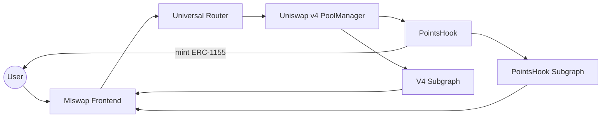

# Mlswap

### Gamified DeFi on Arc — built on Uniswap v4

> Swap. Earn points on-chain. Climb the leaderboard.  
> Mlswap turns every trade into a game — powered by custom Uniswap v4 hooks.


---

## The pitch

Most DEXes stop at “swap and provide liquidity.” Uniswap v4’s **hooks** let pools run custom logic on every trade — and almost nobody is using that surface to make DeFi *fun*.

**Mlswap** is a full Uniswap v4 DEX on **[Arc](https://www.circle.com/arc)** with a native points layer:

1. You swap in a hooked pool  
2. `PointsHook` mints **ERC-1155 points** to your wallet (proportional to volume)  
3. Points are indexed by a dedicated subgraph  
4. Campaign leaderboards update in real time  

No off-chain scorekeeping. No “trust us” points. Rewards are **on-chain collectibles** you can verify in your wallet.

---

## Demo

| | Link |
|---|---|
| **Live app** | [https://app.mlswapx.xyz/](https://app.mlswapx.xyz/) |
| **Video walkthrough** | [Introducing Mlswap — Gamified DeFi on Uniswap v4](https://www.tella.tv/video/introducing-mlswap-gamified-defi-on-uniswap-v4-0lw2) |
| **Explorer** | [Arc Explorer](https://explorer.arc.io/) |

### Judges — try this in 2 minutes

1. Open the [live app](https://app.mlswapx.xyz/) and connect a wallet on **Arc Mainnet** (`chainId: 5042`)
2. Swap on a **PointsHook** pool (look for the hook badge on pools / campaigns)
3. Open **Campaigns** → pick PointsHook → see your rank on the **per-pool leaderboard**
4. Check **Profile / Activity** for swaps and points history

---

## What makes it different

| Typical DEX | Mlswap |
|---|---|
| Swap + LP only | Swap + LP **+ on-chain gamification** |
| Points (if any) are off-chain / centralized | Points minted as **ERC-1155** in the hook |
| Hooks are demos | Hooks are a **product surface** (campaigns, leaderboards) |
| One subgraph for pools | Dual indexing: **V4 markets** + **points balances** |

---

## Features

### Core DEX (Uniswap v4)
- **Swap** — exact-in / exact-out via Universal Router
- **Pools** — browse TVL, fees, hooks; open pool detail with history
- **Positions** — mint, increase, decrease, burn concentrated liquidity
- **Quotes & gas** — live quotes from V4 Quoter; wallet UX via Reown AppKit

### Gamification layer
- **PointsHook** — `afterSwap` mints pool-scoped ERC-1155 points to the trader
- **Campaigns** — hook + attached pools, each with its own leaderboard
- **Leaderboards** — ranked by on-chain points balance (subgraph-backed)
- **Activity & profile** — track trades, points, and campaign standing

### Builder tooling
- Hook metadata & campaign config in one place (`hooksDetail.ts`)
- Separate subgraph for points so campaigns stay fast and accurate

---

## Architecture



**Flow of a points-earning swap**

1. Frontend encodes the user’s address in `hookData` and routes the swap through Uniswap v4  
2. PoolManager executes the swap and calls `PointsHook.afterSwap`  
3. Hook computes points from `|Δamount0|/100 + |Δamount1|/100` and mints ERC-1155 (`tokenId = poolId`)  
4. PointsHook subgraph indexes `TransferSingle` → `PointsBalance`  
5. Campaigns UI queries the leaderboard and ranks traders  

---

## PointsHook (core innovation)

```solidity
function _afterSwap(
    address,
    PoolKey calldata key,
    SwapParams calldata,
    BalanceDelta delta,
    bytes calldata hookData
) internal override returns (bytes4, int128) {
    uint256 pointsToMint =
        SignedMath.abs(delta.amount0() / 100) +
        SignedMath.abs(delta.amount1() / 100);

    _assignPoints(key.toId(), hookData, pointsToMint);
    return (this.afterSwap.selector, 0);
}
```

- Implements Uniswap v4 `BaseHook` + Solmate `ERC1155`
- Only needs `afterSwap` permission — minimal, gas-aware surface
- Points are **per-pool** (token ID = pool ID), so campaigns stay fair and separable
- Users hold real tokens — not a hidden database entry

Deployed PointsHook: [0x759ebc7a9d4236a207cd5ade79d00a02c37bc040](https://explorer.arc.io/address/0x759ebc7a9d4236a207cd5ade79d00a02c37bc040)

---

## Active campaign pools

PointsHook is live on Arc Mainnet for:

| Pair | Fee | What you earn |
|------|-----|----------------|
| USDC / MONKE | 0.30% | Pool-scoped ERC-1155 points |
| USDC / RCH | 0.30% | Pool-scoped ERC-1155 points |
| USDC / SOFT | 0.30% | Pool-scoped ERC-1155 points |

Leaderboards: [app → Campaigns](https://app.mlswapx.xyz/campaigns)

---

## Tech stack

| Layer | Choices |
|-------|---------|
| **Chain** | Arc Mainnet (`5042`) |
| **AMM** | Uniswap v4 — PoolManager, PositionManager, Quoter, Universal Router, Permit2 |
| **Hooks** | Custom `PointsHook` (Foundry) |
| **Frontend** | React 19, Vite, TypeScript, Tailwind v4, wagmi / viem, Reown AppKit |
| **Data** | Dual Graph subgraphs (V4 markets + PointsHook balances) |
| **Extras** | Supabase (app data), lightweight-charts (pool charts) |

---

## Repository layout

```
mlswap/
├── mlSwap-frontend/              # DEX UI — swap, pools, positions, campaigns
├── mlSwap-contract-main/         # Foundry — PointsHook, faucet, mocks
├── mlswap-subgraph/              # Uniswap v4 indexing (pools, swaps, positions)
└── mlswap-pointshook-subgraph/   # Points balances & transfers for leaderboards
```

| Package | Role |
|---------|------|
| `mlSwap-frontend` | Product UI judges interact with |
| `mlSwap-contract-main` | On-chain gamification + deploy helpers |
| `mlswap-subgraph` | Market data for pools / activity / charts |
| `mlswap-pointshook-subgraph` | Rankings & points history |

---

## Deployed contracts (Arc Mainnet)

| Contract | Address |
|----------|---------|
| **PointsHook** | [`0x759e…c040`](https://explorer.arc.io/address/0x759ebc7a9d4236a207cd5ade79d00a02c37bc040) |
| PoolManager | `0xcf3C40142ff5C31b71c59f5191AAe26093742F2a` |
| PositionManager | `0x7d00dB5115Db5e02ef0550E51BB459F7c72e5999` |
| Universal Router | `0x38d1FeCCef299Bba6B826e9cE5B628c817DB03c5` |
| V4 Quoter | `0x277d57385768235e93f0B3fC67b48563Eb4A5a8c` |
| StateView | `0xD786F8D819088de1AFeD102eee548F354b5cD011` |
| Permit2 | `0x58228Bb87820aF037776182e78B41eb4fF82119d` |
| WETH | `0x16F4f71584C523D3f3a96fBbb2b4C8b9dFf44e75` |
| USDC | `0x3600000000000000000000000000000000000000` |

---

## Local development

### Prerequisites
- [Bun](https://bun.sh/) (frontend)
- [Foundry](https://book.getfoundry.sh/) (contracts)
- Node / Yarn + Docker (subgraphs, optional)

### Frontend

```bash
cd mlSwap-frontend
bun install
bun dev
```

Open [http://localhost:3000](http://localhost:3000).

Create a `.env` with:

```env
VITE_WALLETCONNECT_PROJECT_ID=your_project_id
VITE_SUPABASE_URL=
VITE_SUPABASE_ANON_KEY=
```

### Contracts

```bash
cd mlSwap-contract-main
forge build
forge test
```

Key source: `src/PointsHook.sol`

### Subgraphs

```bash
# Market data
cd mlswap-subgraph && yarn && yarn codegen && yarn build

# Points / leaderboards
cd mlswap-pointshook-subgraph && yarn && yarn codegen && yarn build
```

See each package’s README for network-specific deploy commands.

---

## Project structure (frontend product surface)

| Route | Purpose |
|-------|---------|
| `/` | Swap |
| `/pools` · `/pools/:id` | Discover pools & hook badges |
| `/positions` · `/positions/:id` | Manage LP NFTs |
| `/campaigns` · `/campaigns/:id` | Hook campaigns & leaderboards |
| `/activity` | Network / user activity |
| `/profile` | Your points & standing |

---

## Why this matters for Arc + Uniswap v4

- **Shows hooks as a consumer product**, not just a Solidity pattern  
- **Keeps incentives on-chain** — ERC-1155 points are portable and auditable  
- **Full-stack v4 on Arc** — router, LP, indexing, and UX end-to-end  
- **Extensible** — new campaigns = new hook config + pool keys, without rewriting the DEX  

---

## Roadmap

- [ ] More hook types (fee rebates, time-weighted multipliers, referral hooks)
- [ ] Claimable reward seasons settled from campaign leaderboards
- [ ] Public campaign creation UI for token teams

---
